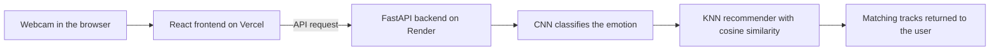

# MoodTune

**Music that matches how you feel right now.** MoodTune reads your facial expression through your webcam and recommends tracks to match your mood.

**[Try the live demo](https://moodtune-v1.vercel.app/)**

> The backend runs on a free Render plan, so the first request may take a few seconds while it wakes up.

<!-- Add screenshots here once you have them, for example:

-->

## Why I built it

Music apps often play the wrong thing for the moment you're in. I wanted to try a different input: instead of asking what you want to hear, MoodTune looks at how you feel and starts from there. It was my final-year project for my BSc in Software Engineering at Kirinyaga University.

## How it works

1. The browser captures your face from the webcam.
2. The React frontend sends it to the FastAPI backend.
3. A convolutional neural network classifies the emotion.
4. A K-nearest-neighbours recommender, using cosine similarity, finds matching tracks.
5. The tracks come back to the interface.

## The emotion model

- Keras/TensorFlow CNN that classifies 48×48 grayscale face images into 7 emotions: angry, disgust, fear, happy, neutral, sad, surprise
- Trained on about 30,000 face images
- **91% accuracy on a held-out test set of 4,165 images** the model never saw during training
- Full training details: [facial-emotion-recognition](https://github.com/codegeekbrian/facial-emotion-recognition)

## The recommendation engine

- K-nearest-neighbours with cosine similarity
- Searches a collection of 64,517 Spotify tracks

## Tech stack

| Layer | Tools |
| --- | --- |
| Frontend | React 18, Vite |
| Backend | Python, FastAPI, Uvicorn |
| Machine learning | TensorFlow, Keras, OpenCV, NumPy, Pandas |
| Recommendations | K-nearest neighbours, cosine similarity |
| Deployment | Vercel (frontend), Render (backend) |

## About the source code

The MoodTune source code is private. I'm happy to walk through the architecture and code in an interview or a call.

## Author

Brian Mutembei · Software Engineering graduate, Kirinyaga University
[GitHub](https://github.com/codegeekbrian) · [Portfolio](https://codegeekbrian.page.gd) · [LinkedIn](https://www.linkedin.com/in/brian-mutembei) · bmutembei715@gmail.com
